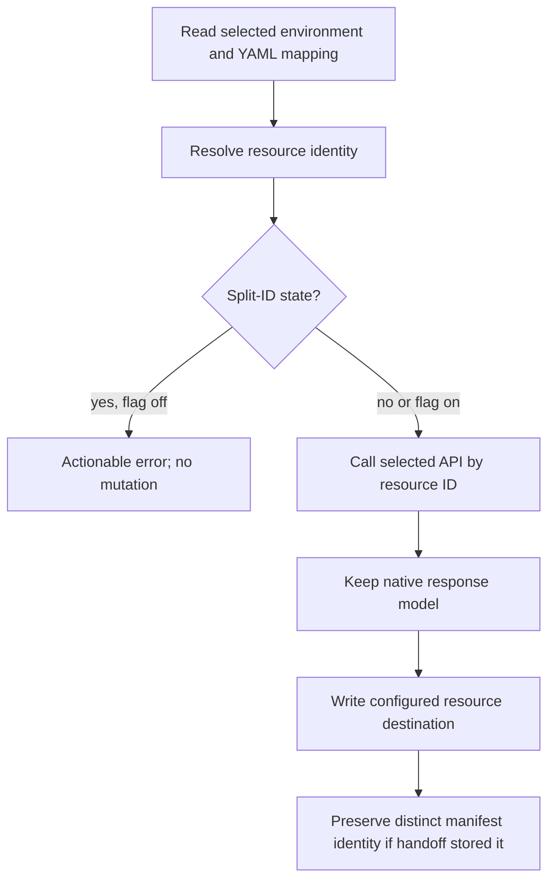

# Developer Portal identity and YAML compatibility

Status: implemented from the approved DP API migration chat.
Scope: existing create, provision, update, and DP-to-ATK workflows; no new UI.

## Contract

Legacy `AppDefinition` remains unchanged. New API methods expose native
`AppResponse` (`appId`, `appProfile`) and list summary models, not legacy-shaped
projections. Resource identity is old `teamsAppId` / new `appId`; manifest identity
is old `appId` / new `appProfile.appDetails.applicationManifest.id`.

Create/get/update validate only the response envelope: a UUID resource `appId`,
an object or null `appProfile`, and resource-ID agreement for get/update. They do
not recursively validate optional profile data or reject additional fields.
Nested identity requirements remain the responsibility of the consuming
operation, including create/update identity checks and DP handoff validation.
The draft manifest type is derived recursively from the manifest package's
`TeamsManifest` union (re-exported by `teamsfx-api`). Draft fields may be missing
or null, including nested fields, while schema version and enum constraints are
retained. No separate handwritten manifest field definitions are maintained.

`teamsApp/create.writeToEnvironmentFile` accepts either `appId` or `teamsAppId`,
never both, in every supported YAML version. The destination remains customizable.
An explicit mapping wins; otherwise resolve `APP_ID`, then `TEAMS_APP_ID` when
empty/missing. Invalid selected values must not fall back. Existing files and
custom destinations are not rewritten.

With `TEAMSFX_NEW_DP_APIS` enabled, new templates use `appId: APP_ID`; with it
disabled they keep `teamsAppId: TEAMS_APP_ID`. Ordinary projects have one ID.
Templates receive only a `NewDeveloperPortalApis` toggle for this choice.
Explicit Mustache branches retain the complete existing URLs and environment
references, changing only the ID names. No computed ID-name/reference variables
are passed to templates. DP handoff applies split-ID runtime bindings internally
after rendering; ordinary template generation does not depend on handoff IDs.
Only unequal-ID DP handoffs persist `APP_MANIFEST_ID` as well as `APP_ID`.
Their manifests and runtime launch references use the manifest ID; DP operations
use the resource ID. No additional YAML action inputs/outputs are introduced.
Split-ID projects require the new API and fail before legacy API mutation.

No resource lookup uses a manifest/external-ID list fallback. Normal app listing
and pagination remain. The new detail contract has no timestamps: freshness
checks use the authoritative list summary `updatedAt`, matched by resource
`appId` (not an identity translation). Failure to obtain required freshness
information is surfaced, never replaced with a local clock or ignored.
The authenticated tenant claim supplies the tenant output for the new API,
not an arbitrary access-control user's tenant.

## Flow



## Invariants

- A resource ID is never overwritten with a manifest ID or vice versa.
- `APP_MANIFEST_ID` is not added to ordinary or equal-ID projects.
- New-client responses retain their native shape; legacy clients retain theirs.
- Missing split-ID resource state cannot fall back to package manifest identity.
- Failed identity validation or new-API lookups do not create a replacement app.
  Legacy lookup/create behavior remains unchanged.
- No unverified timestamp or tenant value is written to environment files.
- Consumers resolve the selected environment, not stale state from another run.

## Boundary

No backend DP changes, API default enablement, YAML version bump, unrelated ID
renames, automatic YAML migration, or repair of manually repointed projects.
Do not extend runtime SDKs or change unrelated template behavior.

## Project migration

Existing projects require no YAML or environment-file rewrite. This remains valid
with either API:

```yaml
- uses: teamsApp/create
  with:
    name: example${{APP_NAME_SUFFIX}}
  writeToEnvironmentFile:
    teamsAppId: TEAMS_APP_ID
```

New projects generated with `TEAMSFX_NEW_DP_APIS=true` instead use:

```yaml
- uses: teamsApp/create
  with:
    name: example${{APP_NAME_SUFFIX}}
  writeToEnvironmentFile:
    appId: APP_ID
```

Either output key may map to a custom environment variable. Do not specify both
keys, even when their destinations are identical. Changing a key is opt-in;
existing `TEAMS_APP_ID` values are reused when the selected destination is empty.
The toolkit does not delete old values or write both ID names unconditionally.

Do not add `APP_MANIFEST_ID` manually for ordinary apps. DP handoff initializes it
only when the package manifest identity differs from the DP resource identity.
Keep `TEAMSFX_NEW_DP_APIS` enabled for those projects. Missing or inconsistent
identity state is an error, not a reason to create a replacement app.

Publish the updated schemas at the existing hosted schema URLs as part of
release. Bundled validation supports the aliases in all supported versions;
updating bundled files alone does not update editor validation against hosted
historical URLs.

## Acceptance Criteria

Each row is an L1 required gate unless explicitly marked otherwise. Test names
carry the AC ID; scenario composition is owned by the linked scenario spec.

| ID | Runtime | Purpose | Gate | Harness | Expected result |
|---|---|---|---|---|---|
| AC-01 | L1 | compatibility | required | all-version schema validator | Either output key is valid; both/neither in an output block fail; omitted output block retains defaults. |
| AC-02 | L1 | operation-integration | required | create driver | Resource ID is written to the configured canonical, legacy, or custom destination. |
| AC-03 | L1 | compatibility | required | driver/env consumer | Missing canonical state reuses legacy ID without duplicate creation or YAML rewrite. |
| AC-04 | L1 | operation-integration | required | driver/resolver | Explicit mapping wins; otherwise canonical wins; invalid nonempty IDs and both output keys fail. |
| AC-05 | L1 | operation-integration | required | HTTP fake | New detail/list results retain native shape, required identity is validated, optional null data is supported, legacy model is unchanged. |
| AC-06 | L1 | compatibility | required | API routing | Existing equal-ID apps use the saved resource ID directly with either API. |
| AC-09 | L1 | compatibility | required | metadata/injection/extension | Both keys and custom mappings remain discoverable by downstream consumers. |
| AC-10 | L1 | operation-integration | required | response/freshness | Authenticated tenant and authoritative summary timestamps are used; missing required data fails explicitly. |
| AC-15 | L1 | compatibility | required | split-ID guard | Flag-off split-ID projects fail with enable-flag guidance before mutation. |
| AC-16 | L1 | operation-integration | required | HTTP fake | Get/download/delete errors do not trigger manifest/external-ID list scans; list pagination still works. |
| AC-17 | L1 | compatibility | required | selected environment | Missing split-ID resource state fails; valid equal-ID update-only projects retain the manifest-ID compatibility route. |
| AC-18 | L1 | operation-integration | required | handoff fake | Missing/invalid response IDs or package identity disagreement fail before inconsistent identity state is persisted. |
